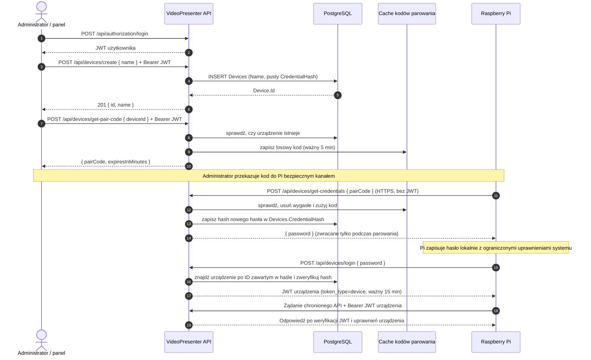

# Rejestracja i autoryzacja urządzeń

Ten dokument opisuje obecny przepływ rejestracji prezentera Raspberry Pi i jego logowania do API.

## Schemat przepływu



## Endpointy

| Endpoint | Kto wywołuje | Działanie |
| --- | --- | --- |
| `POST /api/authorization/login` | Panel / administrator | Zwraca JWT użytkownika. |
| `POST /api/devices/create` | Użytkownik z JWT | Tworzy urządzenie; zwraca `id` i `name`. |
| `GET /api/devices/get-all-devices` | Użytkownik z JWT | Zwraca listę `{ id, name }`. Hash poświadczenia nie jest ujawniany. |
| `POST /api/devices/get-pair-code` | Użytkownik z JWT | Przyjmuje `{ deviceId }`, zwraca jednorazowy kod ważny domyślnie 5 minut. |
| `POST /api/devices/get-credentials` | Raspberry Pi | Przyjmuje `{ pairCode }` bez JWT użytkownika. Kod parowania jest jednorazowym poświadczeniem bootstrapowym; endpoint zużywa go, ustawia hash i zwraca `{ password }`. |
| `POST /api/devices/login` | Raspberry Pi | Przyjmuje `{ password }` i zwraca JWT urządzenia. Nie wymaga JWT. |

Chronione operacje administracyjne wymagają nagłówka:

```http
Authorization: Bearer <user-jwt>
```

## Format poświadczeń

Hasło zwracane przez `get-credentials` składa się z identyfikatora urządzenia i losowego sekretu (`<device-id>.<secret>`). Dzięki temu endpoint `login` przyjmuje tylko hasło, a API może odszukać rekord bez sprawdzania hasła kolejno dla każdego urządzenia. W bazie przechowywany jest wyłącznie hash hasła.

Po udanym logowaniu urządzenie używa zwróconego JWT w nagłówku `Authorization: Bearer <device-jwt>`. Token urządzenia ma claim `token_type=device`; token użytkownika ma `token_type=user`. Chronione endpointy powinny sprawdzać typ podmiotu i ograniczać dane do urządzenia wskazanego w JWT.

## Uwagi operacyjne

- Kod parowania jest jednorazowy i domyślnie ważny 5 minut. Czas można zmienić w `DevicePairing:PairCodeLifetimeMinutes`.
- `get-credentials` dostępny jest bez JWT, ponieważ Pi nie ma jeszcze poświadczeń. Jednorazowy kod autoryzuje wymianę na hasło i powinien być przesłany wyłącznie przez HTTPS.
- Cache kodów jest pamięcią procesu API. Przy wielu instancjach API parowanie wymaga routingu kolejnych żądań do tej samej instancji albo współdzielonego cache, np. Redis.
- Wygasłe kody są usuwane przy tworzeniu lub sprawdzaniu kodu; nie ma osobnego workera.
- Hasło urządzenia jest zwracane Pi tylko przy wymianie kodu. Należy je zapisać poza repozytorium, z uprawnieniami dostępu ograniczonymi do użytkownika usługi.
- JWT ma obecnie 15-minutowy czas życia. Po wygaśnięciu Pi może zalogować się ponownie swoim hasłem.
